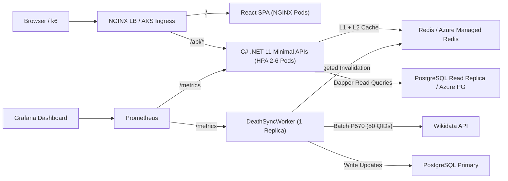

# Are They Dead Or Not?

A production-style proof-of-concept answering *"Is this person dead or not?"* in sub-100ms, built with:

- **Backend:** C# / **.NET 11** Minimal APIs + Dapper + `HybridCache` (L1 in-memory + L2 Redis) + per-IP sliding-window rate limiting (`AddRateLimiter` + `UseForwardedHeaders`)
- **Background Death Sync:** Single-replica `DeathSyncWorker` (`IHostedService`) running a tiered daily sync (`sitelinks >= 10` every 24h, continuous long-tail scan between cycles) at 50 QIDs every 2s via `idx_people_alive_sitelinks`, with `Retry-After` backoff, Wikidata `P570` lookup, PostgreSQL updates, and targeted `HybridCache` invalidation
- **Database:** PostgreSQL 17 Primary + Streaming Read Replica in Docker Compose (and Azure Database for PostgreSQL Flexible Server in Azure), bulk-migrated via `COPY` from a 2.29M-row Wikidata SQLite database with B-tree + bounded `pg_trgm` fuzzy-search indexes
- **Frontend:** React + TypeScript + Vite SPA (search with *"Did you mean...?"* disambiguation, Recent Deaths, In Memory ±2 days, and About This Site)
- **Observability:** OpenTelemetry metrics (`/metrics`), Prometheus scraping, and a pre-provisioned Grafana dashboard (Docker Compose `:3000` and `k8s/observability/`)
- **Load Balancing, Orchestration & IaC:** NGINX Load Balancer (`docker-compose`), Kubernetes (`k8s/` with HPA), Terraform for Azure AKS (`infra/terraform/`), xUnit unit tests, `k6` load/spike simulator, and GitHub Actions PR gate

### Architecture Overview



---

## 1. Preparing the Data (Wikidata → SQLite)

Before migrating data into PostgreSQL, generate `data/wikidata-scripts/celebrities-latest-all.db` using the scripts in [data/wikidata-scripts](data/wikidata-scripts/README.md):

1. **Download the Wikidata entity dump** (~95 GB compressed, using `-x 2 -s 2` to stay within Wikimedia's per-IP connection limits):

   **Linux / WSL2 (Bash):**
   ```bash
   # Install if needed: sudo apt-get install -y aria2
   cd data/wikidata-scripts
   aria2c -c -x 2 -s 2 \
     --max-tries=0 --retry-wait=15 \
     --user-agent="AreTheyDeadOrNot-DataPrep/1.0 (https://github.com/pixelandpen/aretheydeadornot)" \
     https://dumps.wikimedia.org/wikidatawiki/entities/latest-all.json.bz2
   ```

   **Windows (PowerShell):**
   ```powershell
   # Install if needed (open a new PowerShell window afterward): winget install aria2.aria2
   cd data\wikidata-scripts
   aria2c -c -x 2 -s 2 --max-tries=0 --retry-wait=15 --user-agent="AreTheyDeadOrNot-DataPrep/1.0 (https://github.com/pixelandpen/aretheydeadornot)" https://dumps.wikimedia.org/wikidatawiki/entities/latest-all.json.bz2
   ```
2. **Extract celebrities (born since 1900) into SQLite:**
   ```bash
   # Direct Python streaming:
   python3 dump_pipeline.py latest-all.json.bz2 --db celebrities-latest-all.db

   # Or faster multi-core decompression with lbzip2:
   lbzip2 -dc latest-all.json.bz2 | python3 dump_pipeline.py - --db celebrities-latest-all.db
   ```
   *(Alternatively, use `sparql_pipeline.py --db celebrities-latest-all.db` for smaller/filtered subsets — see [data/wikidata-scripts/README.md](data/wikidata-scripts/README.md) for all options.)*

By default, [migrate_sqlite_to_pg.py](data/migrate_sqlite_to_pg.py) reads `./wikidata-scripts/celebrities-latest-all.db` relative to `data/`. You can override this via the `SQLITE_PATH` environment variable or `--sqlite-path` CLI flag.

---

## 2. Quickstart (Local Docker Compose)

1. **Start the infrastructure, load balancer, API replicas, and React UI:**
   ```bash
   docker compose up -d --build
   ```

2. **Migrate your Wikidata SQLite database into PostgreSQL Primary** (streams ~2.29M people + ~2.58M occupations via `COPY` and builds indexes; takes ~1–2 minutes):
   ```bash
   docker compose --profile etl run --rm etl
   ```

3. **Open the app & observability:**
   - Web UI: http://localhost:8080
   - API Search: `http://localhost:8080/api/v1/search?name=Michael%20Jackson`
   - Recent Deaths: `http://localhost:8080/api/v1/recent-deaths`
   - In Memory (±2 days): `http://localhost:8080/api/v1/in-memory`
   - Health Readiness: `http://localhost:8080/health/ready`
   - Grafana Dashboard: http://localhost:3000 (`admin`/`admin` or anonymous viewer)
   - Prometheus: http://localhost:9090

---

## 3. Running Unit & Load Tests

With Docker (no local .NET SDK required):
```bash
docker run --rm -v "$(pwd):/src" -w /src mcr.microsoft.com/dotnet/sdk:11.0 dotnet test
```

For **`k6` load & spike testing**, rate-limiting details, and Azure AKS benchmark results, see [tests/README.md](tests/README.md).

---

## 4. Local Kubernetes Testing

If you have Docker Desktop Kubernetes, `kind`, or `k3d` running with `ingress-nginx`:
```bash
docker build -f src/Api/Dockerfile -t aretheydeadornot-api:latest .
docker build -f src/Web/Dockerfile -t aretheydeadornot-web:latest src/Web
kubectl apply -k k8s/overlays/local
```

---

## 5. Deploying to Azure (AKS + Azure PostgreSQL + Azure Managed Redis)

1. **Authenticate with Azure CLI:**
   ```bash
   az login
   ```
2. **Configure Terraform variables:**
   ```bash
   cd infra/terraform
   cp terraform.tfvars.example terraform.tfvars
   # Edit terraform.tfvars with a strong postgres_admin_password (and adjust regions/SKUs if needed)
   ```
3. **Provision infrastructure:**
   ```bash
   terraform init
   terraform plan
   terraform apply
   ```
   Note the values printed by `terraform output` (`acr_login_server`, `aks_cluster_name`, `postgres_primary_fqdn`, `redis_hostname`, `redis_port`, `resource_group_name`).
4. **Connect `kubectl` to AKS & create Kubernetes secrets:**
   ```bash
   az aks get-credentials --resource-group rg-aretheydeadornot --name aks-aretheydeadornot

   # Fetch the Azure Managed Redis access key
   az extension add --name redisenterprise --allow-preview true
   REDIS_KEY=$(az redisenterprise database list-keys \
     --cluster-name <REDIS_NAME> \
     --resource-group rg-aretheydeadornot \
     --query primaryKey -o tsv)

   # Use single quotes around the PostgreSQL connection string so special characters like $$ are not expanded
   kubectl create namespace aretheydeadornot
   kubectl -n aretheydeadornot create secret generic app-secrets \
     --from-literal=postgres-read-replica='Host=<PRIMARY_FQDN>;Port=5432;Database=celebrities;Username=pgadmin;Password=<PG_PASSWORD>;Ssl Mode=Require' \
     --from-literal=redis="<REDIS_HOST>:<REDIS_PORT>,password=${REDIS_KEY},ssl=True,abortConnect=False"
   ```
   *(Where `<REDIS_NAME>` is the prefix of `redis_hostname` before `.eastus2.redis.azure.net`, and `<REDIS_PORT>` is `10000`.)*
5. **Initialize Azure PostgreSQL (`pg_trgm` + schema) and run the ETL:**
   ```bash
   # Allow your current IPv4 address through the Azure PostgreSQL firewall
   MY_IP=$(curl -4 -s https://api.ipify.org)
   az postgres flexible-server firewall-rule create \
     --resource-group rg-aretheydeadornot \
     --server-name <PRIMARY_SERVER_NAME> \
     --name AllowMyIPv4 \
     --start-ip-address "$MY_IP" \
     --end-ip-address "$MY_IP"

   # Allowlist pg_trgm on Azure Database for PostgreSQL Flexible Server
   az postgres flexible-server parameter set \
     --resource-group rg-aretheydeadornot \
     --server-name <PRIMARY_SERVER_NAME> \
     --name azure.extensions \
     --value PG_TRGM

   # Apply schema and bulk-load SQLite -> Azure PostgreSQL
   cd ../..
   docker run --rm -i \
     -e PGPASSWORD='<PG_PASSWORD>' \
     postgres:17-alpine \
     psql -h <PRIMARY_FQDN> -p 5432 -U pgadmin -d celebrities "sslmode=require" \
     < data/init-primary.sql

   docker build -f data/Dockerfile.etl -t aretheydeadornot-etl:latest data
   docker run --rm \
     -v "$(pwd)/data/wikidata-scripts:/etl/wikidata-scripts:ro" \
     -e PG_PRIMARY_DSN='host=<PRIMARY_FQDN> port=5432 dbname=celebrities user=pgadmin password=<PG_PASSWORD> sslmode=require' \
     aretheydeadornot-etl:latest
   ```
6. **Build, push images to ACR & deploy to AKS (app + observability):**
   ```bash
   az acr login --name <ACR_NAME>
   docker build -f src/Api/Dockerfile -t <ACR_LOGIN_SERVER>/aretheydeadornot-api:latest .
   docker build -f src/Web/Dockerfile -t <ACR_LOGIN_SERVER>/aretheydeadornot-web:latest src/Web
   docker push <ACR_LOGIN_SERVER>/aretheydeadornot-api:latest
   docker push <ACR_LOGIN_SERVER>/aretheydeadornot-web:latest

   # Replace REPLACE_WITH_ACR.azurecr.io in k8s/overlays/azure/kustomization.yaml with <ACR_LOGIN_SERVER>, then:
   kubectl apply -k k8s/overlays/azure
   kubectl apply -k k8s/observability
   kubectl -n aretheydeadornot get pods -w
   ```
7. **Open the live site & Grafana:**
   ```bash
   # Public Load Balancer IP for Website & API:
   kubectl -n ingress-nginx get svc ingress-nginx-controller

   # Private port-forward for Azure Grafana (use 3001 if local Docker Compose Grafana is on 3000):
   kubectl -n monitoring port-forward svc/grafana 3001:3000
   ```
   Open `http://<EXTERNAL-IP>/` for the app and `http://localhost:3001` for Grafana.
8. **Tear down when finished demoing** (avoids ongoing Azure charges):
   ```bash
   cd infra/terraform
   terraform destroy
   ```

---

## 6. GitHub CI/CD & Branch Protection

1. Create a private GitHub repository and push this code.
2. In GitHub **Settings → Branches → Add branch protection rule** for `main`:
   - Enable **Require a pull request before merging**.
   - Enable **Require status checks to pass before merging** and select:
     - `.NET Build & xUnit Tests`
     - `React Typecheck & Build`
     - `Terraform Fmt & Validate`
